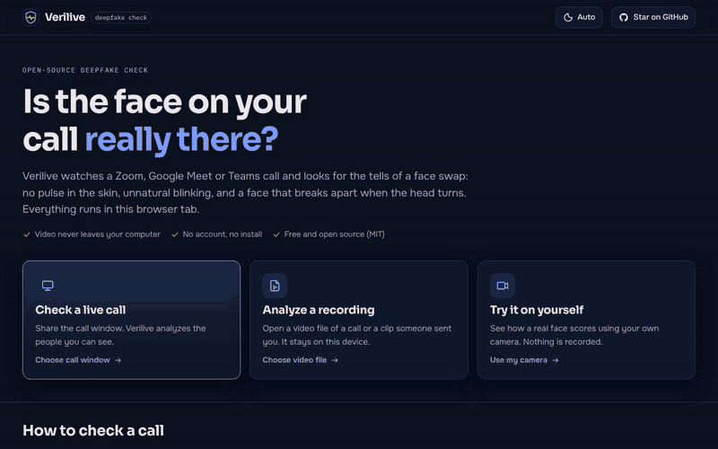
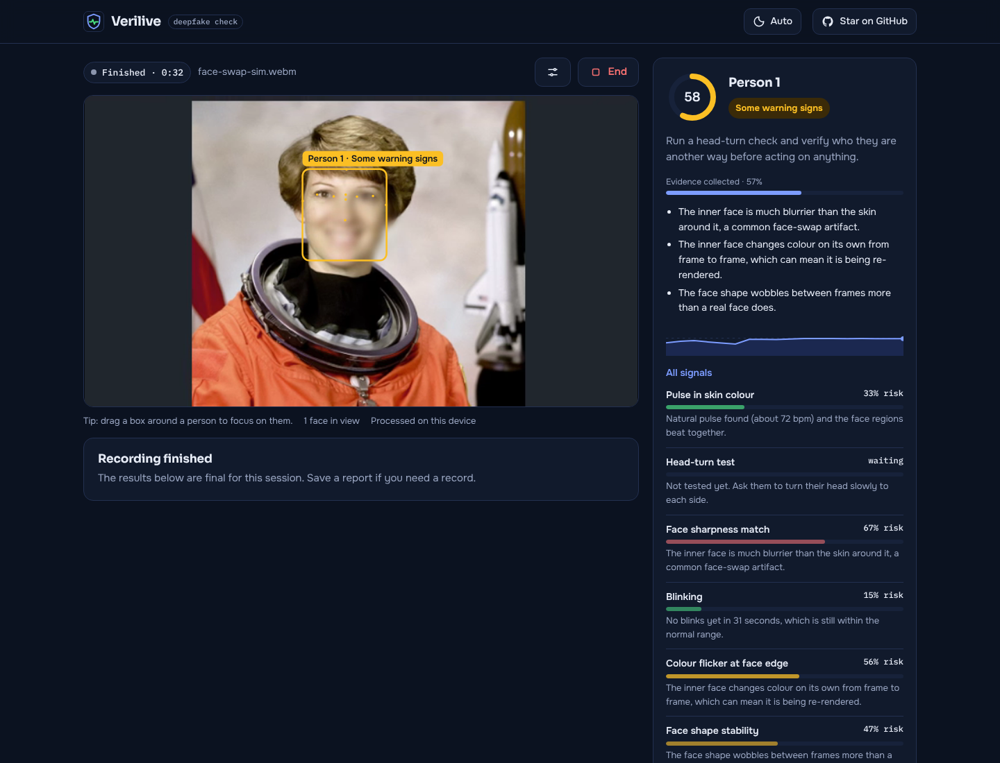
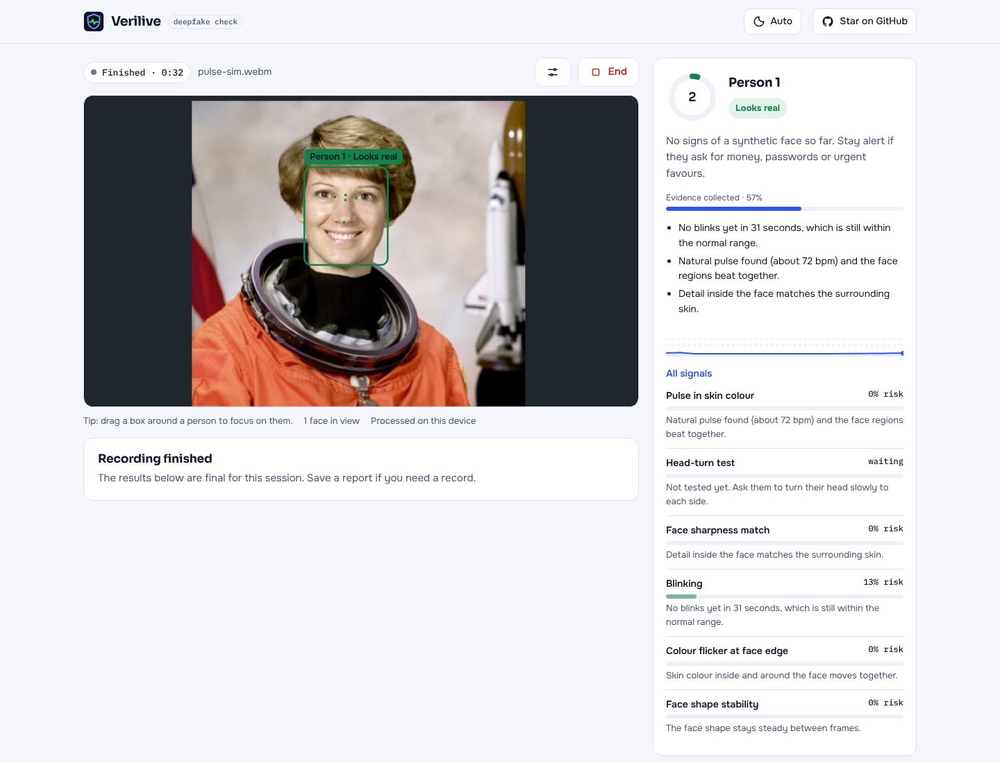

<div align="center">


# Verilive

**Is the face on your video call real?**

An open-source deepfake check for Zoom, Google Meet, Microsoft Teams and any other video call.<br>
It looks for a pulse in the skin, natural blinking and face-swap artifacts, entirely in your browser.

[](https://github.com/Shahrukhalid/verilive/actions/workflows/ci.yml)
[](https://shahrukhalid.github.io/verilive/)
[](LICENSE)


**[Open Verilive →](https://shahrukhalid.github.io/verilive/)** &nbsp;·&nbsp; no install, no account



</div>

## Why

Video-call deepfakes are now used to impersonate executives, relatives and job candidates. Commercial detectors exist, but they are sold to enterprises. Verilive is a free, private alternative anyone can open in a browser tab during a call.

## Features

- **Works with any call app.** Share the Zoom, Teams or Webex window (or a Meet tab) and Verilive analyzes the faces it can see. No plugins, no bots joining your meeting.
- **Six independent signals** grouped into *liveness* (pulse, blinking) and *swap artifacts* (sharpness, colour flicker, shape stability, head-turn test). The worse family decides, so neither a replayed video nor a live face swap can hide behind the other signals.
- **Guided head-turn check.** Face swaps break when the head turns. One click records a 12-second test while you ask the person to turn their head.
- **Several people at once**, each with a risk gauge, evidence meter, plain-language reasons and a risk timeline.
- **Finds small faces.** In gallery view Verilive zooms in automatically, or you can drag a box around a person.
- **Analyze recordings** of calls or clips someone sent you, and **try it on yourself** with your camera.
- **Reports.** Save a JSON report (numbers only, never images) or copy a summary.
- **Private by design.** The face model and all analysis run in WebAssembly in your tab. A strict Content Security Policy blocks every other origin, and there is no server.
- Light and dark themes, keyboard and screen-reader friendly, works on desktop browsers.

## Use it on a call

1. Join the call as usual. Spotlight or pin the person you want to check.
2. Open **[Verilive](https://shahrukhalid.github.io/verilive/)** in Chrome, Edge or Firefox and click **Check a live call**. Pick the call window.
3. Put Verilive next to the call (split screen) so the tab stays visible.
4. After about 15 seconds each person gets a reading: **Looks real**, **Some warning signs** or **Likely synthetic**.
5. For a stronger test, ask them to turn their head slowly and press **Start 12-second check**.

| Flagged: simulated face swap | Looks real: simulated live face |
|---|---|
|  |  |

## How it works

```
video frame ─► MediaPipe face landmarks (478 points, blinks, head pose) ─► 160×160 face crop
            ─► per-person 60 s window ─► 6 signals ─► liveness | artifacts ─► worse family = risk
```

| Signal | What a real face does | What a fake tends to do |
|---|---|---|
| Pulse in skin colour (rPPG) | Skin colour changes slightly with each heartbeat, forehead and cheeks in sync | No clean, consistent pulse |
| Blinking | 8–25 irregular blinks a minute, both eyes | Rare, metronomic or one-eyed blinks |
| Face sharpness match | Eyes and lips are the sharpest part of the face | The pasted inner face is softer than the skin around it |
| Colour flicker at face edge | Inner and outer face change colour together | The re-rendered face shifts colour on its own |
| Face shape stability | Rigid landmarks move as one | The shape shimmers between frames |
| Head-turn test | Stable at any angle | Breaks down past about 30° |

Details, formulas and thresholds: **[docs/HOW_IT_WORKS.md](docs/HOW_IT_WORKS.md)**.

## Honest limitations

Verilive gives **risk signals, not proof**. Heavy compression, beauty filters and bad lighting can make a real person look suspicious, and the best deepfakes may pass. It does not analyze voices yet. Thresholds were set from research and simulations, not a large benchmark. Read **[docs/LIMITATIONS.md](docs/LIMITATIONS.md)**, and if a call asks for money, codes or urgent action, verify the person another way, whatever the score says.

## Run it yourself

```bash
git clone https://github.com/Shahrukhalid/verilive.git
cd verilive
npm install
npm run dev        # http://localhost:5173
```

`npm run build` produces a static site in `dist/` that you can host anywhere (it needs HTTPS for screen sharing).

```bash
npm test           # detector unit tests
npm run e2e        # the real app in Chromium on generated test videos
```

## Project layout

```
src/engine/   detectors and scoring (pure TypeScript, unit-tested)
src/vision/   face landmarks, pixel measurements, small-face search
src/ui/       React interface
tests/        unit tests (synthetic signals) and end-to-end tests (generated videos)
docs/         how it works, limitations, screenshots
```

## Roadmap

- Voice-clone detection on shared tab audio
- Picture-in-picture mini verdict that floats over the call
- Evaluation on public deepfake datasets and published accuracy numbers
- Optional opt-in ONNX classifier for frame-level artifacts

Ideas and research pointers are welcome in [Discussions](https://github.com/Shahrukhalid/verilive/discussions).

## Contributing

Pull requests are welcome. Start with [CONTRIBUTING.md](CONTRIBUTING.md) and the [good first issues](https://github.com/Shahrukhalid/verilive/labels/good%20first%20issue). Please follow the [Code of Conduct](CODE_OF_CONDUCT.md) and report security issues privately ([SECURITY.md](SECURITY.md)).

## Credits

Face landmarks by Google's [MediaPipe](https://github.com/google-ai-edge/mediapipe) (Apache-2.0). Pulse extraction follows the POS method of Wang, den Brinker, Stuijk and de Haan (2017). Test videos are generated from NASA's public-domain portrait of astronaut Eileen Collins. Full list: [NOTICE.md](NOTICE.md).

## License

[MIT](LICENSE) © Shahrukhalid

If Verilive helps you or someone you know, please ⭐ star the repo so more people can find it.
